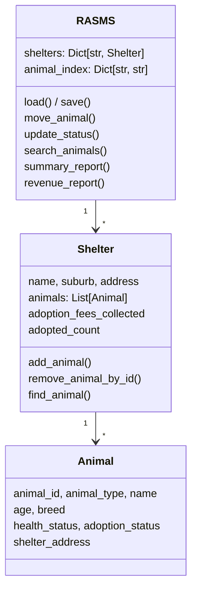

# RASMS: Regional Animal Shelter Management System

A menu-driven Python application for a regional animal welfare authority in South Australia. Staff can track animals across **10 shelters** from Glenelg to Whyalla, move animals between shelters, update health and adoption status, search records, and see reports on shelter capacity and adoption revenue. All data is saved to JSON between sessions.


## The problem

Small and medium shelters often keep records in separate spreadsheets or on paper, which leads to inconsistent data, admin mistakes and no regional overview. RASMS puts every shelter and animal into one system that a regional manager can run from a terminal.

## Features

**Core**
- **View shelter inventory:** every shelter with its address and current animals (ID, name, type, breed, age, health and adoption status)
- **Move an animal between shelters:** updates the animal's shelter address and prints a **movement record** showing the old and new shelter
- **Update status:** change health status (Healthy, Needs Vaccination, Injured, In Treatment) or adoption status (Available, Adopted, In Treatment, Hold), with input validation
- **Save and exit:** writes all changes to disk with a confirmation message

**Advanced**
- **JSON file handling:** loads data at startup and saves it on exit. If the data file is missing or corrupt, it seeds default data automatically
- **Search:** find animals by name, breed or health status (partial matches, ignoring case)
- **Summary report:** total, available and in-treatment animals for each shelter, plus regional totals
- **Adoption fees and revenue tracking:** fees are calculated automatically by animal type and age, and each shelter keeps a running total
- **Object-oriented design:** `Animal` and `Shelter` dataclasses with an `RASMS` controller, making it easy to add shelters or animal types

## Adoption fee rules

| Animal | Under 5 years | 5 years and over |
|--------|---------------|------------------|
| Dog | $300 | $200 |
| Cat | $250 | $150 |
| Rabbit, Bird, Reptile, Other | $150 | $100 |

When an animal is marked **Adopted**, the fee is added to its shelter's revenue and the animal leaves the active inventory.

## Example output

```
✅ MOVEMENT RECORD
Animal: D102 - Buddy
From:   Glenelg Animal Rescue | 12 Paws Street, Glenelg SA 5045
To:     Norwood Animal Care | 21 Parade Road, Norwood SA 5067

✅ ADOPTION RECORDED
Animal: C214 - Luna (Cat, 6 years)
Shelter: Glenelg Animal Rescue
Adoption Fee Charged: $150
Note: Adopted animals are removed from current inventory.

================= SHELTER REVENUE REPORT =================
Shelter                         | Adopted | Fees Collected
-----------------------------------------------------------------
Glenelg Animal Rescue          |       1 | $150
Mawson Lakes Pet Haven         |       0 | $0
Norwood Animal Care            |       0 | $0
...
-----------------------------------------------------------------
REGIONAL TOTAL                 |       1 | $150
```

## Design



Key design decisions:
- **Dataclasses** for `Animal` and `Shelter` keep the models short and make JSON saving simple with `asdict()`.
- **An `animal_index` dictionary** maps each animal ID to its shelter, so finding an animal is a quick lookup instead of searching every shelter. The index is rebuilt after loading and kept in sync on every move and adoption.
- **Controlled values** (`VALID_HEALTH`, `VALID_ADOPTION`, `VALID_TYPES`) stop typos from getting into the data and keep the reports reliable.
- **Self-healing startup:** if `rasms_data.json` is missing or unreadable, the system seeds 10 SA shelters with sample animals, so it works on first run.
- **PEP 8:** snake_case names, UPPER_CASE constants, docstrings throughout and wrapped lines.

## Getting started

No external packages are needed, only the Python standard library.

```bash
python rasms.py
```

The first run creates `rasms_data.json` with the 10 seeded shelters. Changes are saved there when you choose **Save and Exit**.

```
================= RASMS MAIN MENU =================
1) View Shelter Inventory
2) Move an Animal Between Shelters
3) Update an Animal’s Status (Health/Adoption)
4) Search Animals (Name/Breed/Health)
5) Summary Report (Totals / Available / Treatment)
6) View Shelter Revenue Report (Adoptions + Fees)
7) Save and Exit
```

## Future improvements

- **SQLite database** with a foreign key between the shelter and animal tables
- **Adoption history:** keep adopted animals in a separate record instead of removing them, for audits and follow-up
- **Add and register animals** and new shelters from the menu
- **Unit tests** for fee calculation, moves and status changes
- A web interface for shelter staff

## Context

Built for the Programming Fundamentals unit of my Bachelor of Information Technology at the University of the Sunshine Coast (UniSC). The brief was a case study for a fictional regional animal welfare authority, and the shelters and animals are sample data.

## License

[MIT](LICENSE)
